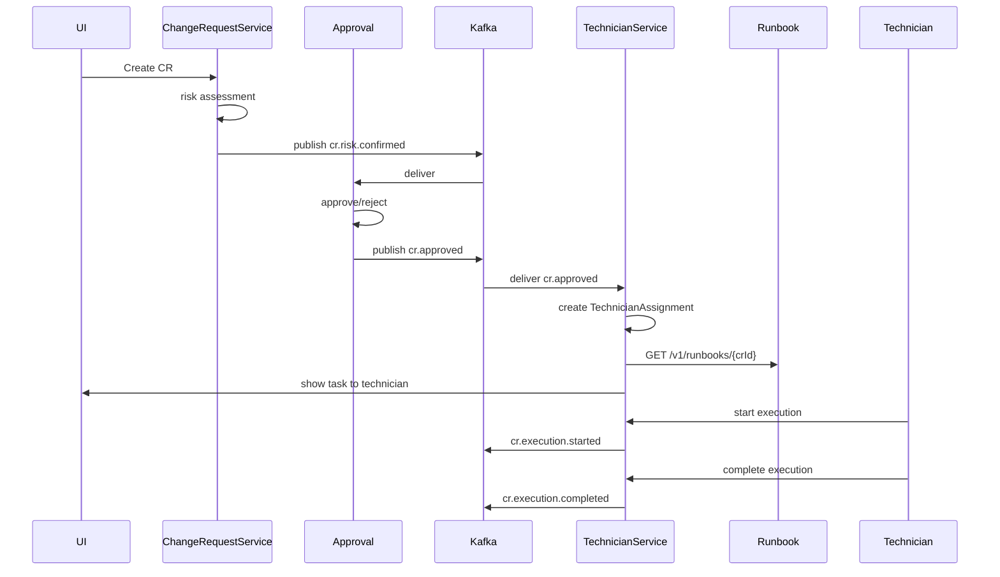

**Executive Summary**
- **Purpose:**: Handover and architecture documentation for Intelligent Change Management (ICM).
- **Scope:**: system overview, service inventory, APIs, sequence diagrams, deployment, security, and audit checklist.

**1. Business Purpose**
- **Description:**: Manage telecom change requests end-to-end — intake, risk assessment, approval, runbook generation, technician execution, and audit.
- **Primary Outcome:**: Safe, auditable changes with automation support.

**2. Stakeholders**
- **Owners:**: Change managers, platform operators.
- **Users:**: Approvers, Technicians, Admins.

**3. User Roles & Auth Model**
- **Roles:**: `APPROVER`, `TECHNICIAN`, (Auth service supports user management).
- **Auth:**: JWT-based stateless auth — each backend parses `Authorization: Bearer <token>`.
- **Files:**: [auth-service security](intelligent-change-management/auth-service/auth-service/src/main/java) (see repo for exact files).

**4. Service Inventory**
- **Services:**:
  - **Auth Service**: authentication, JWT issuance.
  - **Change Request Service**: CR lifecycle, risk ingestion, events.
  - **Approval Service**: approval decisions, event publication.
  - **Runbook Service**: runbook generation & retrieval (uses Feign client).
  - **Technician Service**: assignment, scheduling, execution, logs.
  - **telecom-change-ui**: React frontend.
  - **python-agents-icm**: agent notebooks/models for assessment/runbooks.

**5. Data Model (High level)**
- **ChangeRequest:** id, createdBy, status, details
- **RiskAssessment:** CR id, score, findings
- **Runbook:** CR id, steps, eligibility
- **TechnicianAssignment:** assignmentId, crId, technicianId, status
- **ExecutionLog:** executionId, start/end, notes, rollbackRequired

**6. Integration Patterns**
- **Synchronous:** REST APIs between services.
- **Asynchronous:** Kafka topics for lifecycle events (cr.approved, cr.technician.assigned, cr.execution.started, cr.execution.completed).
- **Service calls:** `RestTemplate` and Feign usage across services.

**7. Key Service APIs**
- **Technician Service (detailed)**
  - File: [TechnicianController](intelligent-change-management/technician-service/src/main/java/com/telecom/technician_service/controller/TechnicianController.java)
  - Base: `/v1/technicians`
  - Endpoints:
    - `POST /assign/{crId}` — assign technician (ROLE_APPROVER). Request: `AssignTechnicianRequest`.
    - `GET /my-tasks` — list tasks for current technician (ROLE_TECHNICIAN).
    - `GET /task/{crId}` — task details (collates CR, assessment, runbook).
    - `POST /{crId}/schedule` — schedule task (ROLE_TECHNICIAN). Request: `ScheduleRequest`.
    - `POST /{crId}/start` — start execution (ROLE_TECHNICIAN).
    - `POST /{crId}/complete` — complete execution (ROLE_TECHNICIAN). Request: `CompleteExecutionRequest`.
    - `GET /execution-history` — completed logs.
    - `GET /dashboard` — assignment counts.

- **Change Request Service (high level)**
  - Exposes CR create/read and assessment endpoints. Emits `cr.approved` topic.
  - Central for CR state machine and risk/assessment ingestion.
  - Files: [GlobalExceptionHandler](intelligent-change-management/change-request-service/change-request-service/src/main/java/com/telecom/change_request_service/exception/GlobalExceptionHandler.java)

- **Runbook Service**
  - Provides `/v1/runbooks/{crId}` to fetch generated runbooks.
  - Integrates with change-request via Feign client.

- **Approval Service**
  - Listens for risk-confirmed events; publishes `cr.approved` after approval.

**8. Sequence Diagram (approval → technician execution)**

**9. Deployment & Runtime**
- **Ports:** check each `application.yml`. Example: Technician service runs on `9006` ([application.yml](intelligent-change-management/technician-service/src/main/resources/application.yml)).
- **DB:** MySQL per service. Ensure schemas exist or add migrations.
- **Kafka:** local broker expected at `localhost:9092` in dev config.

**10. Configuration Checklist**
- **Secrets:** Move `jwt.secret` out of repo; use environment or vault.
- **URLs:** Replace hard-coded external service URLs with env vars.
- **Schema Migrations:** Add Flyway/Liquibase for DBs.

**11. Security Checklist**
- **JWT propagation:** Ensure services that call others either accept unauthenticated calls or propagate tokens.
- **Role checks:** Validate `@PreAuthorize` annotations cover sensitive operations.
- **Input validation:** Controllers use `@Valid`; `GlobalExceptionHandler` centralizes validation errors (see file linked above).

**12. Observability**
- **Logs:** Use structured logging; correlate requests with a trace id.
- **Metrics:** Expose Prometheus metrics endpoints.
- **Tracing:** Consider adding OpenTelemetry for cross-service traces.

**13. Reliability**
- **Resilience:** Add retries and circuit breakers for external REST calls.
- **Event validation:** Add schema validation for Kafka messages.

**14. Audit & Compliance**
- **Audit trail:** `ExecutionLog` stores start/end, notes, rollback flag.
- **Approval records:** Ensure `cr.approved` messages and approval metadata are stored.
- **Retention & export:** Add export tools for audit data as needed.

**15. Actionable Next Steps (priority)**
- **1.** Add DB migration scripts (Flyway) for all services.
- **2.** Move secrets to environment/vault.
- **3.** Implement token propagation for `ExternalServiceClient` or secure inter-service calls.
- **4.** Add schema validation for Kafka payloads and fail fast for malformed messages.
- **5.** Add basic observability (metrics + tracing).

---
**Appendix — Key Files**
- Technician controller: [TechnicianController.java](intelligent-change-management/technician-service/src/main/java/com/telecom/technician_service/controller/TechnicianController.java)
- Technician config: [application.yml](intelligent-change-management/technician-service/src/main/resources/application.yml)
- Kafka config: [KafkaConfig.java](intelligent-change-management/technician-service/src/main/java/com/telecom/technician_service/config/KafkaConfig.java)
- Auth util: [AuthUtil.java](intelligent-change-management/technician-service/src/main/java/com/telecom/technician_service/security/AuthUtil.java)
- ChangeRequest global exceptions: [GlobalExceptionHandler.java](intelligent-change-management/change-request-service/change-request-service/src/main/java/com/telecom/change_request_service/exception/GlobalExceptionHandler.java)

---
If you want, I can now:
- generate a slide-style PDF from this markdown,
- expand each service section with full request/response JSON examples, or
- create runnable infra (docker-compose) for local dev.
Tell me which of those you'd like next.